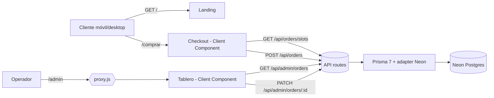

# Tech Design — Café La Sierra: del pedido a tu puerta

> Consume: [`docs/01-producto/PRD.md`](../01-producto/PRD.md) y [`docs/02-diseno/DESIGN.md`](../02-diseno/DESIGN.md).
> Decisiones individuales en [`adrs/`](adrs/). Los hallazgos de la revisión adversarial están
> incorporados (sección 8).

## 1. Objetivo técnico

Convertir la landing estática de Café La Sierra en un producto con dos superficies sobre una
misma base de datos:

1. **Checkout público** (`/comprar`): el cliente arma su pedido (2 cafés del catálogo), entrega
   datos de envío (zona con tarifa fija y franja de entrega) y confirma. Pago en efectivo
   contra entrega — no hay pasarela.
2. **Tablero del operador** (`/admin`): kanban de 5 estados con semáforo contra la franja
   comprometida y filtros por día y zona.

Restricciones del curso: desplegable en **Vercel** y persistencia en **PostgreSQL de Neon**.

## 2. Arquitectura general

Un solo proyecto **Next.js 16 (App Router)** desplegado en Vercel: UI (Server + Client
Components) y API (route handlers) juntas (ADR-0001). La persistencia es **Neon Postgres**
accedida con **Prisma 7 + `@prisma/adapter-neon`** (driver serverless por HTTP/WebSocket,
apto para funciones efímeras de Vercel) (ADR-0002, ADR-0003).



```
src/
  app/                        rutas: / , /comprar , /admin , /admin/login
  app/api/orders/             POST (crear pedido) y slots/ (GET franjas pedibles)
  app/api/admin/              login/ (POST) , orders/ (GET listado) , orders/[id]/ (PATCH estado)
  components/                 landing; checkout/ComprarCafe.jsx ; admin/Tablero.jsx ; ui/
  data/content.js             copy, catálogo (2 cafés) y tabla de zonas con tarifa — autoridad del servidor
  lib/time.js                 única vía fecha/franja → instante; cortes; semáforo (ADR-0007)
  lib/orders.js               validación server-side del body, transiciones, serialización (ADR-0009)
  lib/admin-auth.js           clave única → cookie HMAC firmada (ADR-0006)
  lib/db.js                   cliente Prisma singleton con adapter Neon (ADR-0003)
  proxy.js                    barrera de /admin y /api/admin/* (se re-verifica en cada handler)
```

## 3. Modelo de datos (ADR-0004)

Una sola tabla **`orders`** desnormalizada: un pedido = una tarjeta del tablero. No hay tablas
de clientes (compra como invitado), productos (catálogo estático en `content.js`) ni zonas
(tabla estática de 4 zonas con tarifa fija, ADR-0010).

| Columna | Tipo | Nota |
|---|---|---|
| `id` | uuid PK | `gen_random_uuid()` |
| `items` | jsonb | snapshot `[{productId,title,unitPrice,qty}]` calculado por el servidor |
| `subtotal` / `delivery_fee` / `total` | int | COP; calculados contra catálogo y zona (ADR-0009) |
| `customer_name` / `customer_phone` / `address` | text | datos de entrega |
| `zone_id` / `zone_name` | text | id validado contra la tabla estática + snapshot del nombre |
| `date` | date | día de entrega comprometido (hora de pared del negocio) |
| `slot` | text | `manana` \| `tarde` (ventanas y cortes en `lib/time.js`) |
| `status` | text | `NUEVO` → `PREPARANDO` → `EN_CAMINO` → `ENTREGADO`, o `CANCELADO` |
| `notes` | text? | nota opcional del cliente (≤500) |
| `idempotency_key` | uuid **UNIQUE** | garantía anti doble envío (ADR-0008) |
| `created_at` / `updated_at` | timestamptz | auditoría mínima |

Índice `(date, zone_id)` para los filtros del tablero.

## 4. Contrato de API (REST simple, ADR-0005)

Todas las respuestas llevan `Cache-Control: no-store`. Errores: `{ "error": CODE, ... }`.

| Endpoint | Auth | OK | Errores |
|---|---|---|---|
| `GET /api/orders/slots` | — | `200 { slots: [{date, slot}] }` franjas pedibles según reloj del servidor | — |
| `POST /api/orders` | — | `201` pedido creado · `200` replay idempotente (misma `idempotencyKey`) | `422 VALIDATION_ERROR {fields}` · `500 INTERNAL_ERROR` |
| `POST /api/admin/login` | clave | `200 {ok}` + cookie `admin_session` HttpOnly | `401 INVALID_CREDENTIALS` · `503 ADMIN_NOT_CONFIGURED` |
| `GET /api/admin/orders?date&zone` | cookie | `200 { orders: [...] }` | `401` · `422` |
| `PATCH /api/admin/orders/:id` `{status}` | cookie | `200` pedido actualizado | `401` · `404` · `409 INVALID_TRANSITION` · `422` |

**Validación server-side (ADR-0009):** el body del POST solo aporta identificadores y datos de
entrega. Precios, tarifas, nombres de zona y totales se calculan contra `src/data/content.js`;
la franja se re-valida contra el reloj del servidor en la zona del negocio. El cliente no puede
inventar precios ni pedir franjas vencidas, domingos o fechas inexistentes.

**Transiciones de estado:** `TRANSITIONS` en `lib/orders.js` es la única fuente:
`NUEVO→{PREPARANDO,CANCELADO}`, `PREPARANDO→{EN_CAMINO,CANCELADO}`,
`EN_CAMINO→{ENTREGADO,CANCELADO}`; `ENTREGADO` y `CANCELADO` son finales. El `PATCH` usa
`updateMany({ where: { id, status: actual } })`: si otra pestaña ya movió el pedido, cuenta 0 y
responde `409` en lugar de pisar el cambio.

## 5. Tiempo del negocio (ADR-0007)

- Zona fija `America/Bogota` (UTC-5, sin DST). Toda conversión fecha/franja → instante pasa
  por `src/lib/time.js`; nadie usa `new Date()` sobre strings de fecha fuera de ese módulo.
- Franjas: **mañana** 9:00–12:00 (corte para pedir el mismo día: **8:00**) y **tarde**
  14:00–18:00 (corte: **12:00**). Entregas **lunes a sábado** — el domingo no se ofrece.
- La web acepta pedidos 24/7 (PRD caso borde 6): `GET /api/orders/slots` solo ofrece franjas
  futuras válidas y el POST re-valida el corte con el reloj del servidor.

**Semáforo** (`trafficLight` en `lib/time.js`, misma función pura en server y browser):

| Color | Condición |
|---|---|
| 🟢 verde | franja en el futuro (ni hoy ni vencida) |
| 🟡 amarillo | entrega es hoy y la franja no venció — o venció pero el pedido ya está `EN_CAMINO` |
| 🔴 rojo (parpadea) | fin de la franja pasó y el pedido sigue en `NUEVO`/`PREPARANDO` |
| — | `ENTREGADO` / `CANCELADO` no llevan semáforo |

## 6. Flujo de compra e idempotencia (ADR-0008)

La `idempotencyKey` (uuid) nace en el navegador una vez por intento de compra. "Confirmar" se
deshabilita durante el envío (PRD caso borde 5), pero la garantía real es la constraint
`UNIQUE (idempotency_key)`: un doble clic, un reintento de red o un refresh que re-envía el
mismo intento reciben `200` con **el mismo pedido**, nunca uno duplicado. Si la franja cerró
mientras el cliente llenaba el formulario, el servidor responde `422 {fields:['slot']}` y el
checkout recarga las franjas y pide elegir otra.

## 7. Seguridad (detalle en `docs/08-seguridad/SECURITY-REPORT.md`)

- **Admin** (ADR-0006): clave única del dueño (`ADMIN_PASSWORD`) comparada en tiempo constante
  (HMAC de ambas); sesión = cookie `HttpOnly`/`SameSite=Lax`/`Secure` firmada con HMAC-SHA256
  (`ADMIN_SESSION_SECRET`), TTL 7 días. `src/proxy.js` es barrera optimista sobre `/admin` y
  `/api/admin/*`; cada handler/página re-verifica de forma autoritativa.
- **Inputs**: validación estricta server-side (tipos, formatos, catálogo, zonas, franjas,
  uuid). Sin HTML crudo: React escapa todo el contenido.
- **Secretos** solo en variables de entorno (Vercel/`.env` ignorado por git).

## 8. Revisión adversarial — hallazgos incorporados

1. **"Deshabilitar el botón no evita duplicados"**: un reintento de red del mismo POST creaba
   dos pedidos. → `idempotency_key UNIQUE` + replay `200` (ADR-0008). El diseño v1 confiaba
   solo en el `disabled`.
2. **"Dos pestañas del tablero se pisan"**: dos operadores (o dos pestañas) moviendo la misma
   tarjeta dejaban estados inconsistentes (p. ej. `ENTREGADO` → `PREPARANDO`). → transiciones
   explícitas + `updateMany` condicional al estado actual con `409` (sección 4).
3. **"El cliente decide qué franja es válida"**: calcular las franjas en el navegador permitía
   pedir franjas vencidas con el reloj local corrido. → `GET /api/orders/slots` con el reloj
   del servidor y re-validación del corte dentro del POST (ADR-0007, ADR-0009).

## 9. Riesgos aceptados (decisiones del dueño del producto — no "arreglar de paso")

- **Sin rate limiting** en `POST /api/orders` y `POST /api/admin/login`: aceptado para el MVP
  (ver SECURITY-REPORT). Mitigación futura: Vercel WAF / upstash ratelimit.
- **Clave única sin usuarios ni recuperación**: un solo operador (PRD no-alcance).
- **Tablero por polling (60 s)**, sin tiempo real: suficiente para el volumen esperado.
- **Catálogo y zonas estáticos en código**: cambiarlos es un deploy; el PRD lo asume.
- **Sin notificaciones al cliente** (PRD no-alcance): la confirmación en pantalla es el único
  comprobante.
