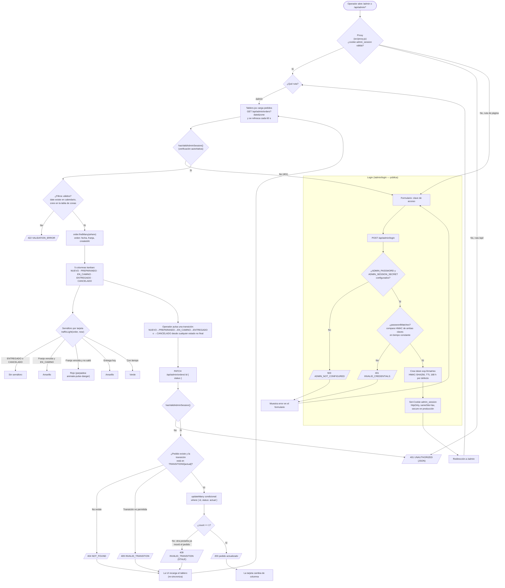

# Tablero del operador — diagrama de flujo (v1.0.0)

## Historial

| Versión | Fecha | Cambio |
|---|---|---|
| 1.0.0 | 2026-10-26 | Versión inicial: login por clave única, cookie HMAC, tablero kanban con semáforo y transiciones |

## Notas

- **Doble barrera (ADR-0006):** el Proxy (`src/proxy.js`) es optimista; `hasValidAdminSession()` se repite en cada handler (`GET /api/admin/orders`, `PATCH /api/admin/orders/:id`). Si el tablero recibe `401`, redirige a `/admin/login`.
- **Semáforo:** corre contra el **fin de la franja comprometida** (`slotEndInstant`) en la zona del negocio (`America/Bogota`): verde = con tiempo, amarillo = la entrega es hoy (o vencida pero ya en camino), rojo parpadeante = la franja venció y el pedido no salió. Estados finales no llevan semáforo. Se recalcula en cada render y el tablero se refresca solo cada 60 s.
- **Concurrencia entre pestañas (ADR-0005):** el `PATCH` usa `updateMany` condicional al estado actual (`where { id, status: actual }`); si otra pestaña ya movió el pedido, `count == 0` → `409` y la UI re-sincroniza con `load()` en lugar de pisar el cambio.
- **Sin cuentas ni roles:** una sola clave compartida (`ADMIN_PASSWORD`); la sesión dura `ADMIN_SESSION_TTL_HOURS` (168 h por defecto) en una cookie HttpOnly firmada con HMAC-SHA256.
