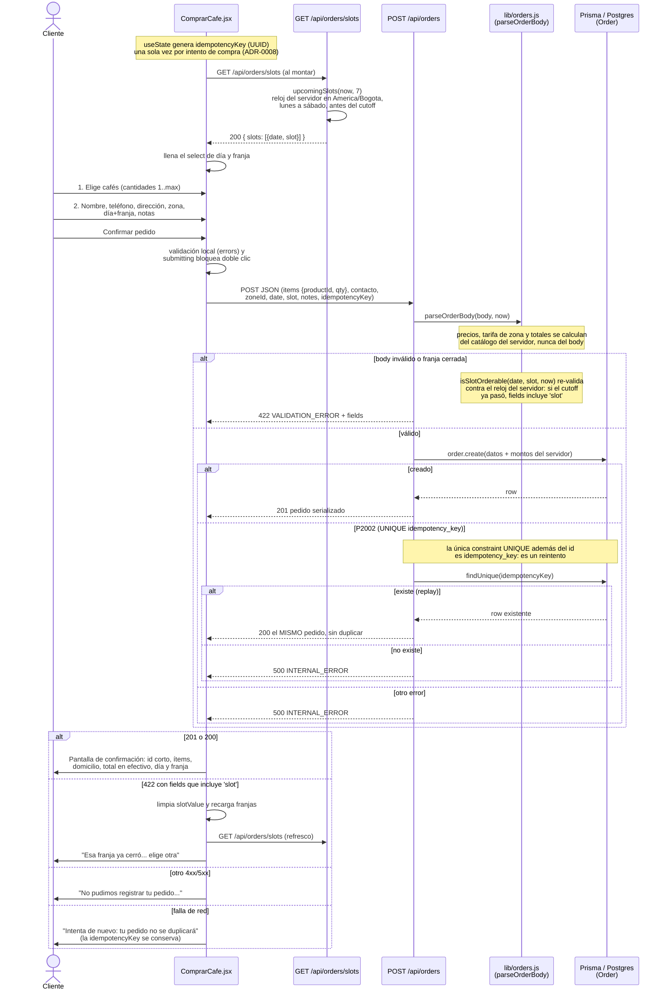

# Pedido de café — diagrama de secuencia (v1.0.0)

## Historial

| Versión | Fecha      | Cambio                                    |
|---------|------------|-------------------------------------------|
| 1.0.0   | 2026-10-26 | Versión inicial, generada desde el código |

## Diagrama

## Notas

- **Franjas:** `GET /api/orders/slots` decide qué franjas son pedibles con el reloj del servidor (`upcomingSlots`, zona `America/Bogota`); el cliente solo las muestra. El `POST` vuelve a validar con `isSlotOrderable`: si el cutoff pasó mientras el cliente llenaba el formulario, responde `422` con `fields: ['slot']` y la UI recarga las franjas.
- **Idempotencia (ADR-0008):** la `idempotencyKey` nace una vez por intento (`crypto.randomUUID()` en `useState`). Ante `P2002` el servidor busca el pedido por `idempotency_key` y devuelve `200` con el mismo pedido: un doble clic o un reintento de red nunca duplican.
- **El servidor es la fuente de verdad:** títulos, precios unitarios, tarifa de zona, subtotal y total se calculan en `parseOrderBody` desde `src/data/content.js`; del body solo se toman ids y cantidades.
- **Fuera del diagrama:** `GET /api/admin/orders` y `PATCH /api/admin/orders/:id` (requieren sesión admin; ver `admin-flujo.md`).
