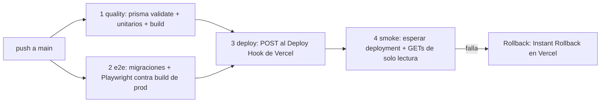

# Deploy Plan — Café La Sierra

> Consume: código + [`tests/`](../../tests/) + [`SECURITY-REPORT.md`](../08-seguridad/SECURITY-REPORT.md).
> Implementado en [`.github/workflows/ci-cd.yml`](../../.github/workflows/ci-cd.yml).

## 1. Entornos

| Entorno | Dónde | Base de datos | Variables |
|---|---|---|---|
| **Producción** | Vercel (proyecto `cafe-la-sierra`) | Neon, rama `production` (pooled) | En Vercel: `DATABASE_URL`, `ADMIN_PASSWORD`, `ADMIN_SESSION_SECRET` |
| **E2E (CI)** | GitHub Actions, Environment `e2e` | Neon, rama `development` | Secrets: `E2E_DATABASE_URL`, `E2E_DATABASE_URL_UNPOOLED` (admin: defaults de CI) |
| **Local** | `npm run dev` | Neon, rama `development` | `.env` (git-ignored), copiado de `.env.example` |

Regla dura: **nada ni nadie fuera de Vercel usa la rama `production` de Neon**. Desarrollo y
tests escriben pedidos reales → siempre rama de desarrollo (`.env` / `.env.e2e` / secrets E2E).

## 2. Pipeline (único camino a producción)

`vercel.json` desactiva el deploy automático por Git (`git.deploymentEnabled: false`): Vercel
**solo** construye cuando el workflow lo dispara. El pipeline es determinístico (no gasta
tokens ni depende de un agente) y tiene **4 gates** — antes, durante y después del deploy:

1. **quality** — `prisma validate`, tests unitarios (franjas/semáforo/validación) y
   `next build` de producción. Sin DB real (placeholders).
2. **e2e** — aplica migraciones a la rama de desarrollo y corre Playwright contra
   `next build && next start` (lo mismo que se despliega). **Si un test falla, no hay deploy.**
   Concurrencia 1: dos corridas no comparten la rama de datos a la vez.
3. **deploy** — `POST` al **Deploy Hook** de Vercel (secret `VERCEL_DEPLOY_HOOK_URL`). CI no
   ve ningún secret de la app: Vercel construye `main` con sus propias variables.
4. **smoke** — espera el estado `Vercel` **de ese commit** (no del anterior) y verifica en
   producción, solo lectura: `/` 200, `/comprar` 200, `/api/orders/slots` JSON válido,
   `/admin` sin sesión → 307 y `/api/admin/orders` sin sesión → **401** (la PII queda cerrada).

## 3. Migraciones

- Fuente: `prisma/migrations/` (versionadas en git, generadas con `prisma migrate dev` contra
  la rama de desarrollo).
- A producción se aplican **manualmente y antes de mergear** el código que las necesita:
  `npx prisma migrate deploy` con `DATABASE_URL_UNPOOLED` de la rama `production`
  (conexión directa). El esquema actual es aditivo (una tabla): sin ventanas de corte.
- Las columnas nuevas deben ser compatibles hacia atrás (nullable o con default) para que el
  deployment anterior siga funcionando durante el build.

## 4. Secretos y configuración (quién ve qué)

| Secreto | Vive en | Lo ve |
|---|---|---|
| `DATABASE_URL` (production) | Vercel → Environment Variables (Production) | Solo runtime de Vercel |
| `ADMIN_PASSWORD`, `ADMIN_SESSION_SECRET` | Vercel (Production) | Solo runtime de Vercel |
| `E2E_DATABASE_URL`, `E2E_DATABASE_URL_UNPOOLED` | GitHub → Environment `e2e` | Solo el job e2e |
| `VERCEL_DEPLOY_HOOK_URL` | GitHub → Environment `production` | Solo el job deploy |
| `PRODUCTION_URL` (variable, no secreta) | GitHub → Variables | Job smoke |

## 5. Recovery

- **Deploy malo que pasó los gates**: *Instant Rollback* en Vercel al deployment anterior
  (1 clic, sin rebuild). El código se revierte con `git revert` + push (vuelve a pasar gates).
- **Migración mala**: Neon *Point-in-time restore* / branch desde un instante previo;
  restaurar `production` desde ese branch. Los datos de pedidos son el único estado.
- **Secreto comprometido**: rotar en Vercel/GitHub (`ADMIN_SESSION_SECRET` invalida todas las
  sesiones admin al instante — es el mecanismo de revocación del ADR-0006).

## 6. Checklist de puesta en producción (primera vez)

1. Proyecto Neon con ramas `production` y `development`; `prisma migrate deploy` en ambas.
2. Proyecto Vercel enlazado al repo con las 3 variables de Production.
3. Deploy Hook creado en Vercel (rama `main`) → secret `VERCEL_DEPLOY_HOOK_URL` en GitHub
   (Environment `production`), variable `PRODUCTION_URL`, secrets E2E en Environment `e2e`.
4. Push a `main` → verificar los 4 jobs en verde → abrir la URL pública y hacer un pedido real
   de prueba → verlo en `/admin` y marcarlo `CANCELADO`.
