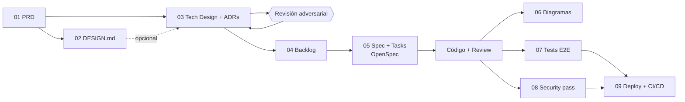

# Documentación — pipeline AI-First

Esta carpeta está ordenada en el mismo orden en que se construyó el proyecto. Cada paso
**consume el documento anterior**. Ninguno es un documento suelto: si el PRD cambia, el
diseño técnico, el backlog y las specs tienen que responder a ese cambio.

## Los pasos

| # | Carpeta | Artefacto | Cómo se generó | Consume |
|---|---|---|---|---|
| 01 | [`01-producto/`](01-producto/) | [`PRD.md`](01-producto/PRD.md) | Skill `generar-prd-conversacional`, revisado a mano | La idea del producto (landing existente) |
| 02 | [`02-diseno/`](02-diseno/) | [`DESIGN.md`](02-diseno/DESIGN.md) | Sistema visual derivado de la marca, tokens → `tailwind.config.js` | PRD |
| 03 | [`03-arquitectura/`](03-arquitectura/) | [`TECH-DESIGN.md`](03-arquitectura/TECH-DESIGN.md) + [`adrs/`](03-arquitectura/adrs/) | Diseño técnico decisión por decisión + revisión adversarial (hallazgos en §8) | PRD (+ DESIGN) |
| 04 | [`04-backlog/`](04-backlog/) | [`BACKLOG.md`](04-backlog/BACKLOG.md) | Ítems ordenados por dependencias, cada uno citando sus ADRs | PRD + TECH-DESIGN + ADRs |
| 05 | [`05-specs/`](05-specs/) | [`openspec/`](../openspec/) (en la raíz) | OpenSpec: `propose → apply → archive`, un change por ítem del backlog | Un ítem del BACKLOG |
| 06 | [`06-diagramas/`](06-diagramas/) | [`pedido-secuencia.md`](06-diagramas/pedido-secuencia.md) + [`admin-flujo.md`](06-diagramas/admin-flujo.md) | Mermaid derivado del código real | Código |
| 07 | [`07-testing/`](07-testing/) | [`tests/`](../tests/) (en la raíz) + [`README.md`](07-testing/README.md) | Playwright E2E sobre los criterios y casos borde del PRD | PRD + código |
| 08 | [`08-seguridad/`](08-seguridad/) | [`SECURITY-REPORT.md`](08-seguridad/SECURITY-REPORT.md) | Security pass (solo análisis, con evidencia en el código) | Código + TECH-DESIGN |
| 09 | [`09-deploy/`](09-deploy/) | [`DEPLOY-PLAN.md`](09-deploy/DEPLOY-PLAN.md) + [`ci-cd.yml`](../.github/workflows/ci-cd.yml) | Deploy pass (diseña antes de ejecutar); gates: build → E2E → deploy → smoke | Código + tests + SECURITY-REPORT |

En la raíz quedan los dos archivos que leen las herramientas, no las personas:
[`CLAUDE.md`](../CLAUDE.md) (contexto y reglas para el agente) y [`README.md`](../README.md)
(portada del proyecto).

## Trazabilidad: cómo se ve que un documento "responde" al anterior

Un ejemplo real de este repo, de punta a punta:

1. **PRD**, caso borde 5: *"Doble envío: el botón 'Confirmar' se deshabilita al primer clic"*.
2. **Revisión adversarial** sobre el diseño v1: deshabilitar el botón no cubre el reintento
   de red ni el refresh → se duplicarían pedidos (domicilios fantasma que cuestan plata).
3. **TECH-DESIGN §6** + [ADR-0008](03-arquitectura/adrs/0008-idempotencia-creacion-pedido.md):
   `idempotencyKey` por intento de compra + constraint `UNIQUE (idempotency_key)`; el replay
   devuelve `200` con el mismo pedido.
4. **BACKLOG**, ítem #4: *"API de pedidos: POST idempotente + franjas"*, citando ADR-0008.
5. **OpenSpec**: change `2026-10-26-api-pedidos-idempotente` → spec vigente
   [`order-api`](../openspec/specs/order-api/spec.md).
6. **Test**: unitario (`src/lib/orders.test.js`, precios del body ignorados) y E2E
   (`tests/comprar-errores.spec.js`, doble envío → un solo pedido en el tablero).

Otra cadena corta: PRD caso borde 3 (franjas imposibles) → ADR-0007 (zona fija + cortes en
`lib/time.js`) → spec `business-time` → test unitario del corte 08:00/12:00 → E2E de franja.
